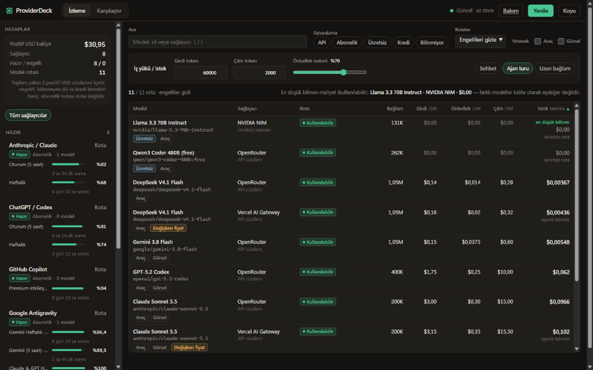

# ProviderDeck

[](https://github.com/haliltalhaertan/ProviderDeck/actions/workflows/ci.yml)
[](https://github.com/haliltalhaertan/ProviderDeck/releases/latest)
[](https://github.com/haliltalhaertan/ProviderDeck/releases)
[](LICENSE)

[English README](README.md) · [Ajan Kurulum Rehberi (`AGENTS.md`)](AGENTS.md)

**Abonelik kotalarını** (5 saatlik + haftalık), **15+ API cüzdan bakiyesini** ve **iş yüküne göre en ucuz model rotalarını** tek ekranda izleyen; **yerel, salt-okunur ve telemetrisiz** web paneli ve Windows sistem tepsisi aracı.

Sıfır frontend build adımı (saf HTML/CSS/JS, CDN yok) ve hafif Python yerel HTTP servisi ile çalışır.



> **Windows Sistem Tepsisi Önizlemesi:**
> ```text
> ProviderDeck · $30,95 · 14:00
> Claude: %68 · 5s %82
> Codex: %74 · 5s %91
> Copilot: %94
> Google: %96,4 · 5s %88,5
> Muse: %64 · 5s %100
> ```

---

## Windows İçin Tek Tıkla İndir (Python Gerektirmez)

En güncel taşınabilir Windows paketini [**GitHub Releases**](https://github.com/haliltalhaertan/ProviderDeck/releases/latest) sayfasından indirebilirsiniz:

1. **`ProviderDeck-v0.2.1-windows-x64.zip`** arşivini indirin (doğrulama için `SHA256SUMS.txt` dahildir) ve `ProviderDeck` klasörünü bilgisayarınızda bir yere çıkarın.
2. **`ProviderDeck.exe`** dosyasına çift tıklayın — yerel panel (`http://127.0.0.1:8766`) ve Windows sistem tepsisi simgesi otomatik başlar.
3. **İsteğe bağlı API anahtarları:** `.env.example` dosyasını `ProviderDeck.exe` ile aynı klasörde `.env` olarak kopyalayıp anahtarlarınızı ekleyin. Yerel CLI abonelikleri (Claude Code, Codex, Antigravity, Muse Code) otomatik ve salt-okunur okunur.
4. Arka plan servisini kapatmak için **`ProviderDeck-Stop.cmd`** dosyasına çift tıklayın.

> Linux, macOS veya Python kullananlar [Releases](https://github.com/haliltalhaertan/ProviderDeck/releases/latest) sayfasındaki `.whl` paketini (`pip install providerdeck-*.whl` → `providerdeck`) kurabilir veya aşağıdaki kaynak kod kurulumunu kullanabilir.

---

## Yapay Zekâ Ajanıyla Tek Adımda Kurulum

Aşağıdaki promptu **Claude Code, Codex, Antigravity, Cursor, Muse Code veya Hermes** içine yapıştırmanız yeterlidir:

```text
https://github.com/haliltalhaertan/ProviderDeck reposunu yerelde bir klasöre klonla, AGENTS.md dosyasını oku, Python sanal ortamı (.venv) oluşturup requirements.txt bağımlılıklarını kur, birim testlerini çalıştırarak doğrula ve ProviderDeck'i salt-okunur modda (`python launch.py`) başlat. Mevcut CLI kimlik/ayar dosyalarımı değiştirme, hiçbir API anahtarını ekrana basma veya commit etme ve ücretli model isteği atma.
```

---

## Özellikler

- **Kodlama Abonelikleri (Haftalık + 5 Saatlik Kotalar):**
  - Anthropic / Claude Code (`~/.claude/.credentials.json` veya OAuth)
  - OpenAI ChatGPT / Codex (`~/.codex/auth.json`)
  - Google Antigravity (`agy -p /usage --output-format json` + `/credits`, model isteği harcamaz)
  - Meta Muse Code CLI (`muse usage --json`, Linux/macOS'ta doğrudan, Windows'ta WSL üzerinden)
  - GitHub Copilot ve OpenCode Go / Zen
- **15+ API Cüzdanı ve Katalog:**
  - OpenRouter, Vercel AI Gateway, Experiential Labs, UberLLM, Venice, VoidAI, Refuseless, OrcaRouter, Outrun, NanoGPT, NVIDIA NIM, Meta Model API, Nous Portal ve `config.yaml` ile özel OpenAI-uyumlu geçitler.
- **İş Yüküne Göre Maliyet Tahmini & Aynı-Model Karşılaştırması:**
  - Girdi token, çıktı token ve önbellek isabet oranına (`cache%`) göre gerçek tahmini maliyeti hesaplar; yalnızca birebir aynı `canonical_key` altındaki rotaları yan yana karşılaştırır.
- **Native Windows Sistem Tepsisi:**
  - Üzerine gelindiğinde pozitif USD toplamını ve seçili tüm aboneliklerin haftalık + `5s` kalan yüzdelerini gösterir; sağ tık menüsüyle abonelikler gizlenip açılabilir.
- **Salt-Okunur Bakım Sayfası (`/maintenance`):**
  - Kalıcı şema/uç nokta entegrasyon hatalarını izler, yalnızca izinli resmi dokümanları kontrol eder; hiçbir kodu veya ayarı otomatik değiştirmez.

---

## Manuel Kurulum ve Çalıştırma

```bash
git clone https://github.com/haliltalhaertan/ProviderDeck.git
cd ProviderDeck
python -m venv .venv

# Windows PowerShell:
.venv\Scripts\Activate.ps1
# Linux / macOS:
# source .venv/bin/activate

pip install -r requirements.txt
```

1. API anahtarlarınız için `.env.example` dosyasını `.env` olarak kopyalayıp kullandığınız anahtarları doldurun.
2. Başlatın:
   ```bash
   python launch.py
   ```
   *(Windows'ta doğrudan `scripts/start.cmd` ve `scripts/stop.cmd` kullanılabilir.)*

---

## Testler

```bash
python -m unittest discover -s tests -p "test_*.py" -v
node tests/ui.test.cjs
```

## Lisans

[GNU GPL v3](LICENSE)
